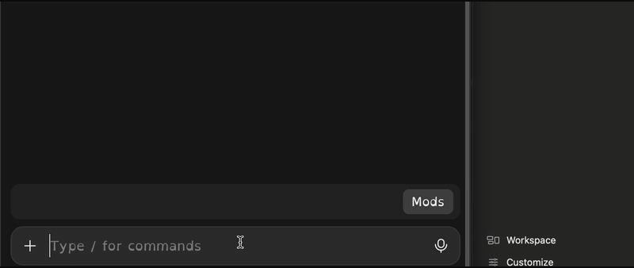
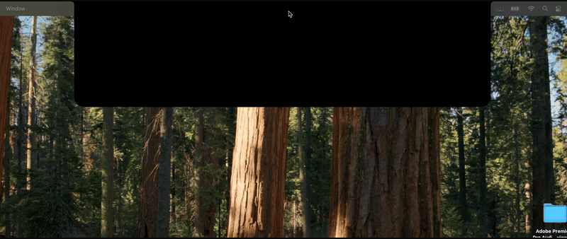
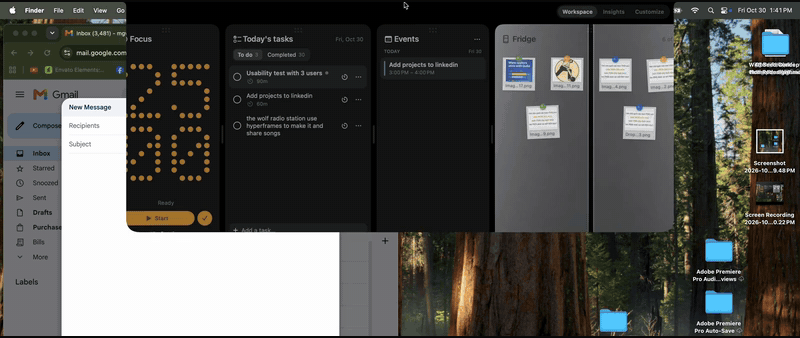

# Notcho

**Plan your day in the notch. Tell your AI to send it to Notcho.**

Notcho is a free, open-source Mac planner that lives in your MacBook's notch. Hover over the notch and your day opens: tasks, a focus timer, notes, your calendar and a Fridge for files. A full Planner window helps you plan the day, block time on your calendar, set weekly goals and keep plan pages for projects.

It works with the AI you already use. Claude, Codex and other AI tools can read and change your tasks, notes and calendar blocks through Notcho's built-in MCP server.

Everything stays on your Mac. No account, no server, no tracking.







## What you'll need

| To... | You need |
|---|---|
| Use Notcho | A Mac on macOS 14 (Sonoma) or newer. Apple silicon or Intel. Nothing else to install. |
| Connect your AI | An AI app that supports MCP, like Claude desktop, Claude Code or Codex. |
| Change or rebuild it | Apple's Command Line Tools (one command, below) and an AI coding agent if you like. Full Xcode is not needed. |

Macs without a notch work too: Notcho sits at the top center of the screen.

## Install

1. Download **Notcho.zip** from [Releases](../../releases/latest) and double-click it.
2. Drag **Notcho** into your **Applications** folder.
3. Open it. macOS will say it can't check the app, because Notcho is free and not sold through Apple. Click **Done**.
4. Open **System Settings → Privacy & Security**, scroll down, and click **Open Anyway** next to Notcho. Confirm once.

That's it. Notcho appears in your notch and in the menu bar. You only do step 4 once.

Notcho asks for Calendar access to show your events, and for Reminders and notifications if you turn on phone sync or task reminders. Every permission is optional: say no and the rest of the app still works.

## Connect your AI

Notcho includes an MCP server. Point your AI app at it:

**Claude Code** (in Terminal):

```bash
claude mcp add notch -- /Applications/Notcho.app/Contents/MacOS/Notcho cli mcp
```

**Claude desktop:** Settings → Developer → Edit Config, then add:

```json
{
  "mcpServers": {
    "notch": { "command": "/Applications/Notcho.app/Contents/MacOS/Notcho", "args": ["cli", "mcp"] }
  }
}
```

**Codex:** add to `~/.codex/config.toml`:

```toml
[mcp_servers.notch]
command = "/Applications/Notcho.app/Contents/MacOS/Notcho"
args = ["cli", "mcp"]
```

Restart the AI app, then try: *"Add 'Send portfolio to Julia' at 3 PM to my notch."*

## Make it yours

Notcho is meant to be changed. Don't like something? Ask your AI agent to change it. A new skin, a different layout, a new card: open this folder in Claude Code, Codex or any coding agent and describe what you want. [AGENTS.md](AGENTS.md) tells the agent how the app is built and how to rebuild it.

To build it yourself:

```bash
xcode-select --install
```

```bash
./make-app.sh
```

The first command installs Apple's Command Line Tools (a few minutes, once). The second builds Notcho and installs it to `/Applications`.

## Privacy

- Your tasks and settings live in `~/Library/Application Support/Notcho/`.
- Daily notes and plan pages are plain Markdown files in iCloud Drive → Notch, so you can read them on your phone.
- Phone sync uses an Apple Reminders list called "Notch". There is no Notcho server.
- Notcho never talks to an AI on its own. Your AI app talks to Notcho, on your Mac.

## Found a bug?

Menu bar icon → **Report a Bug…**, or [open an issue](../../issues/new).

## About

Designed by Miguel Gomez and built by directing AI coding agents. MIT licensed.
